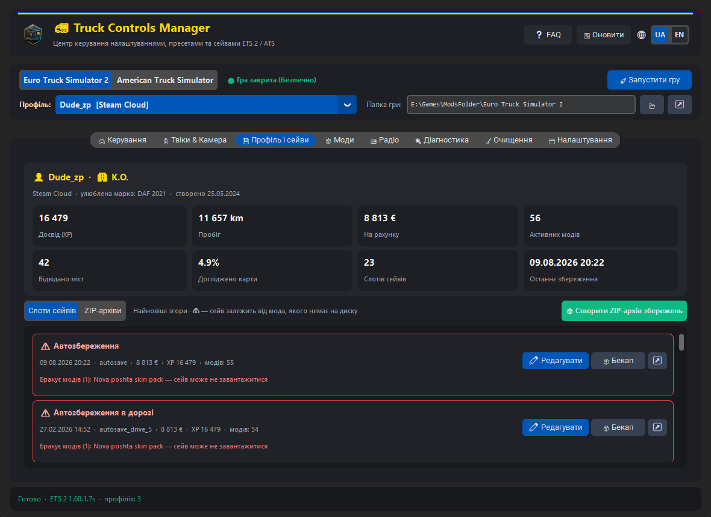
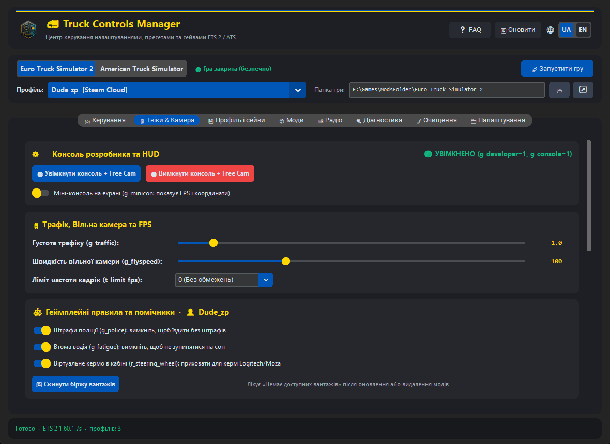
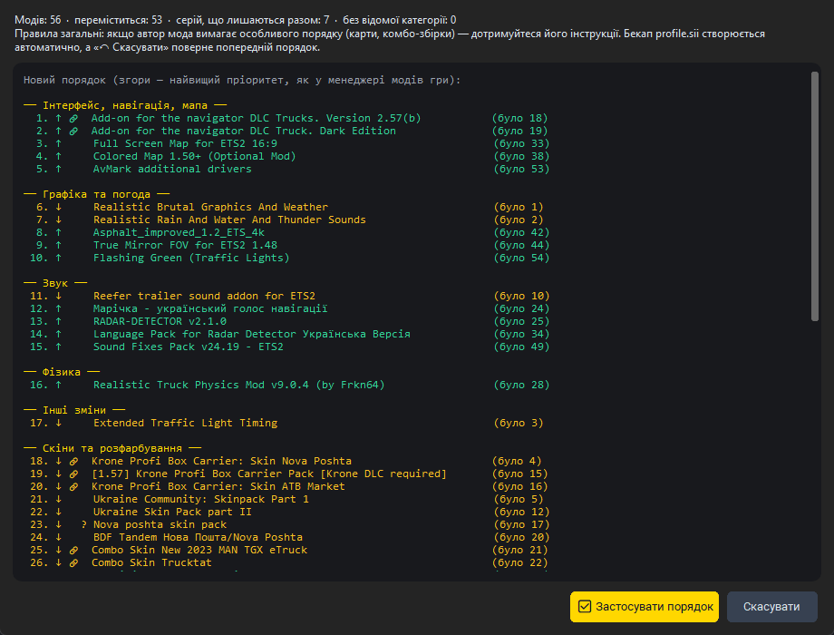
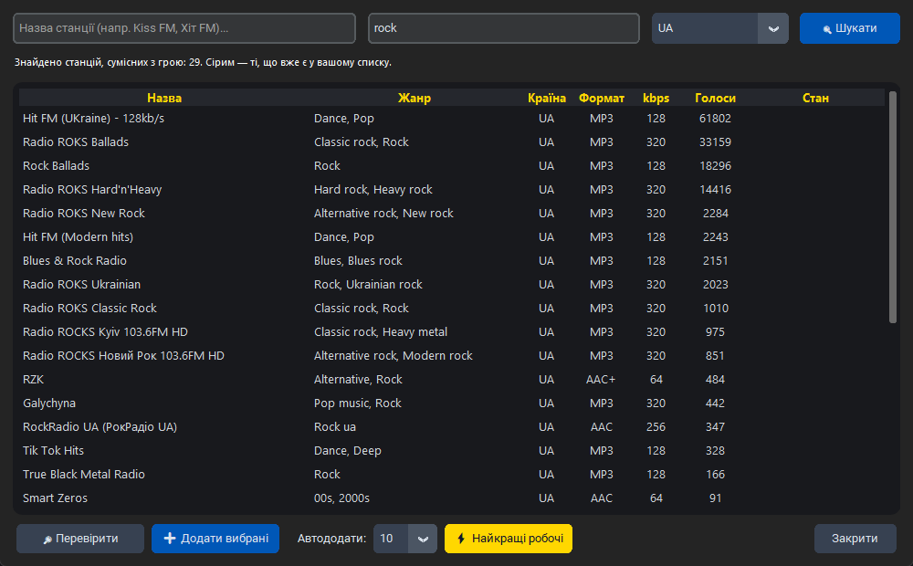
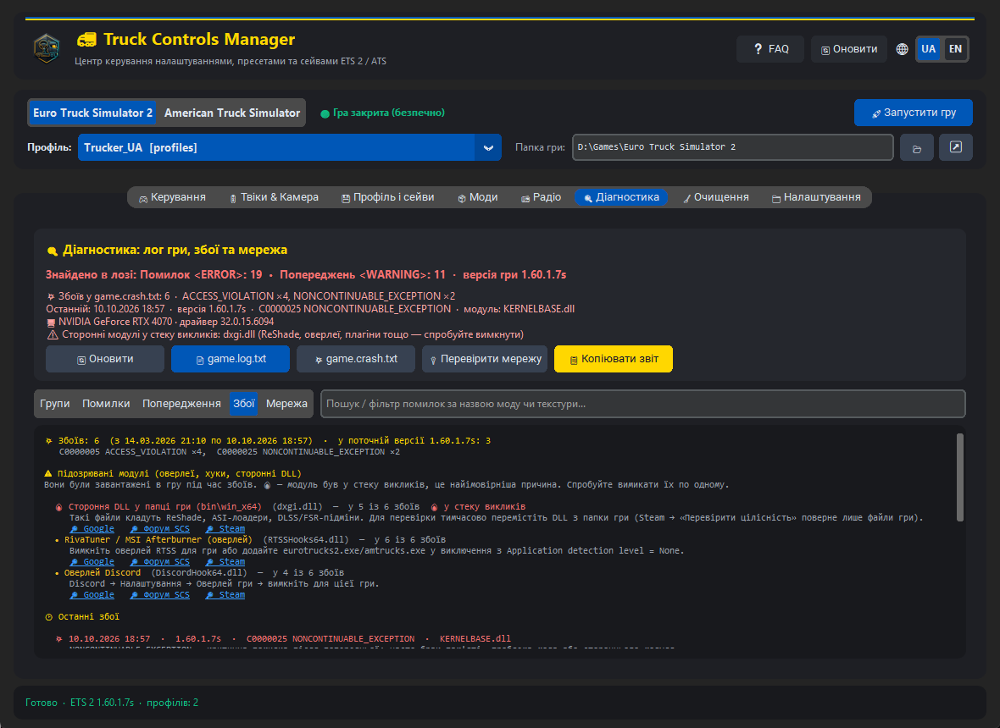
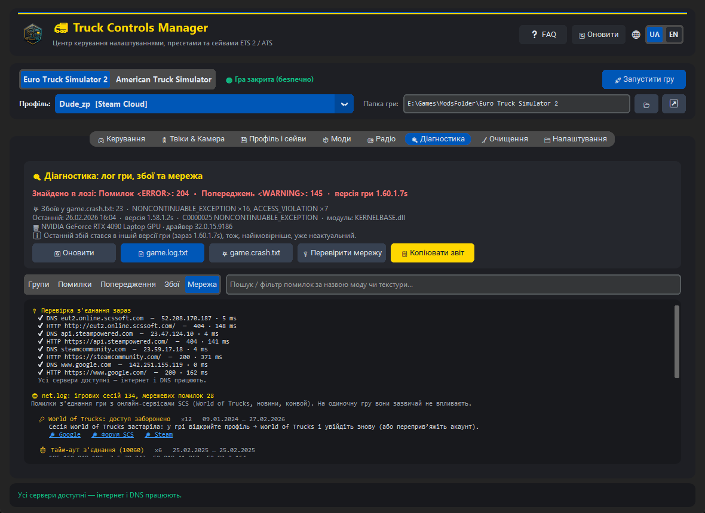
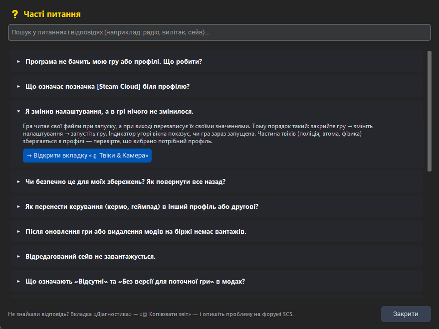

# 🚛 Truck Controls & Tweaks Manager (ETS 2 & ATS) — v3.0

Потужний, сучасний та чистий інструмент для гравців **Euro Truck Simulator 2** та **American Truck Simulator**.

Повністю переписаний з нуля на базі **CustomTkinter**, без стороннього брендингу, реклами чи донатів. Повна рідна підтримка **української мови** та довільного розміщення папок гри на будь-якому диску.

[](https://github.com/Dudezp/truck-controls-manager/releases/latest)

## 📸 Скриншоти

| Профіль і сейви | Твіки гри |
|:---:|:---:|
|  |  |
| **Автосортування модів** | **Пошук радіостанцій** |
|  |  |
| **Аналіз вильотів** | **Перевірка мережі** |
|  |  |
| **Часті питання (FAQ)** | |
|  | |

---

## 🌟 Можливості програми

### 1. 📂 Довільні шляхи до ігор (Виправлено головну проблему!)
- Повна підтримка користувацьких директорій збережень гри (наприклад, параметр `-homedir` на диску `D:`, `E:` для економії місця на системному `C:`).
- **Автовизначення шляху**: програма знаходить Steam через реєстр і читає параметр запуску `-homedir` гри; якщо його немає — бере папку «Документи» (з урахуванням перенесення в OneDrive).
- Можливість у будь-який момент вибрати або змінити шлях для кожної гри окремо — шлях, вибраний вручну, завжди має пріоритет. Кнопка «Визначити шляхи автоматично» повертає автовизначення.
- Автоматичне збереження у `settings.json`.
- Захист від помилково вибраної директорії (програма відрізнить папку встановлення в Steam від папки профілів і підкаже правильний шлях).

### 2. 🎮 Пресети керування (controls.sii)
- Автоматичний пошук профілів як у локальній папці `profiles`, так і в хмарних `steam_profiles`.
- Підтримка **Steam Cloud профілів**: їхні `config.cfg`, `profile.sii` і папка `save` лежать у `Steam\userdata\<акаунт>\<appid>\remote\profiles\<профіль>` — програма знаходить їх автоматично.
- Розшифрування зашифрованих SCS AES нікнеймів та перетворення hex-імен у зрозумілий текст.
- Створення власних пресетів в 1 клік (*«Кермо Moza/Logitech»*, *«Геймпад DualSense/Xbox»*, *«Клавіатура»*).
- Автоматичне створення резервних копій перед кожною заміною.
- **Експорт та імпорт пресетів** у `.zip` (кнопки 📤 і «Імпорт пресету») — щоб ділитися налаштуваннями керма з друзями.

### 3. ⚙️ Розширена панель твіків та налаштування геймплею

Змінні записуються туди, звідки їх читає гра (за документацією SCS): загальні — у `config.cfg` гри, профільні (поліція, втома, кермо, фізика, гальма, скидання ринку) — у `config.cfg` / `config_local.cfg` вибраного профілю. Перед записом робиться бекап (5 останніх копій; для Steam Cloud — у папку `Config_Backups`, щоб копії не потрапляли в хмару).

Усі картки розміщені у зручній скролабельній панелі (`CTkScrollableFrame`), тому жоден повзунок чи підказка ніколи не обрізаються при будь-якому масштабі екрана!

- **Консоль розробника та HUD**:
  - `g_developer` ("1" / "0") та `g_console` ("1" / "0") в один клік.
  - `g_minicon` — перемикач наекранної міні-консолі (відображення FPS, завантаження та координат).
- **Трафік, Вільна камера та Ліміт FPS**:
  - `g_traffic` — плавний повзунок від 0.0 (пусті дороги) до 10.0 (максимальні затори).
  - `g_flyspeed` — швидкість вільної камери від 10 до 300 (за замовчуванням 100).
  - `t_limit_fps` — вибір обмеження FPS: 0 (Без обмежень), 60, 75, 90, 120, 144, 165, 240 для усунення розривів кадру та перегріву.
- **Геймплейні правила та помічники**:
  - `g_police` — вимкнення штрафів поліції (швидкість, світлофори).
  - `g_fatigue` — вимкнення втоми водія (їзда без обов'язкових зупинок на сон).
  - `r_steering_wheel` — приховування віртуального керма в салоні (ідеально для власників фізичних рулів G29/Moza).
  - `g_force_economy_reset` — кнопка швидкого скидання біржі вантажів (лікує проблему «Немає доступних вантажів» після оновлення модів). Повторне натискання повертає значення в 0.
- **Фізика вантажівки, кабіни та причепа**:
  - `g_cam_physics_value` — фізика камери водія (нахил голови при розгоні/гальмуванні від 0.0 до 2.0).
  - `g_cabin_suspension_stiffness` — жорсткість підвіски кабіни (м'яке хитання або жорсткість від 0.0 до 1.0).
  - `g_truck_stability` — стійкість тягача (від 0.0 до 1.0).
  - `g_trailer_stability` — стійкість причепа (від 0.0 до 1.0).
  - `g_brake_intensity` — ефективність гальм від 0.1 до 2.0.
- **Оптимізація графіки та FPS**:
  - `g_pedestrian` — вимкнення пішоходів для приросту FPS у містах.
  - `r_cloud_shadows` — вимкнення тіней від хмар для слабких відеокарт.
- **Кнопка скидання**: швидке повернення всіх твіків до заводських рекомендованих значень.
- **Повна шпаргалка гарячих клавіш**:
  - `~`, `0`, `Num 8/4/5/6`, `Num 9/3`, `Коліщатко миші` (швидкість на льоту), `Ctrl + F9` (телепорт з причепом), `goto <місто>`, `g_set_time`, `g_set_weather`, `warp`.

### 4. 👤 Профіль і сейви
- **Картка профілю**: компанія, улюблена марка, досвід, пробіг, гроші на рахунку, відвідані міста, частка дослідженої карти, кількість модів і слотів (дані з `profile.sii` та `info.sii`).
- **Слоти сейвів**: усі збереження профілю з датою, грошима й досвідом; попередження ⚠, якщо сейв залежить від мода, якого немає на диску.
- **Бекап і відновлення окремого слота** або всієї папки `save` у ZIP. Перед відновленням автоматично робиться страхувальна копія.
- **Редактор сейву** (✏): гроші, досвід, ADR-класи та навички (0–6). Програма розбирає бінарний `game.sii` (BSII) повністю і змінює лише байти потрібних полів; перед записом автоматично створюється бекап слота (`_pre_edit_…`). Закрийте гру перед редагуванням.

### 5. 📦 Моди: діагностика та автосортування
- Порядок модів профілю (як у менеджері модів гри), розмір і джерело (папка `mod` або Steam Workshop).
- **Проблеми**: увімкнені, але відсутні на диску моди; моди Workshop без версії для поточної гри (`versions.sii`).
- **Невикористані**: моди, які не ввімкнені в жодному профілі гри, з розміром — щоб звільнити місце (кнопка «Підписки Workshop»).
- Назви модів беруться з профілів, `manifest.sii` або публічного Steam Web API (кешуються в `%LOCALAPPDATA%\TruckControlsManager`).
- **🧮 Автосортування** порядку модів профілю за правилами (згори вниз): інтерфейс → графіка й погода → звук → фізика → інші зміни → скіни → тюнінг та інтер'єри → тягачі → причепи й вантажі → AI-трафік → моделі й моди-залежності → карти. Категорію визначає `manifest.sii` мода, далі теги Steam Workshop, далі назва. Моди однієї серії (спільний початок назви) лишаються разом, а ваш порядок у межах групи зберігається. Перед записом — попередній перегляд, бекап `profile.sii` і кнопка «↶ Скасувати». Гру треба закрити.

### 6. 📻 Інтернет-радіо (`live_streams.sii`)
- Таблиця всіх станцій з пошуком, фільтром за мовою та сортуванням.
- **🌐 Знайти станції** — пошук в Інтернеті (відкритий каталог radio-browser.info) за назвою, жанром і країною. Показуються лише прямі потоки MP3/AAC, які програє гра. «Додати вибрані» або **⚡ Найкращі робочі**: програма сама перевіряє найпопулярніші нові станції й додає лише ті, що справді грають.
- Додавання, видалення, «обране» ★, перевірка, чи потік живий.
- Власні станції запам'ятовуються окремо: якщо «Оновити з Інтернету» в грі їх затре — кнопка «↺ Мої станції» поверне їх.

### 7. 🔍 Діагностика: лог, збої, мережа
- `game.log.txt`: помилки та попередження **згруповані за джерелом** (мод або файл гри), окремі види «Помилки» / «Попередження», пошук.
- **Аналізатор збоїв** (`game.crash.txt`): пояснення коду винятку простою мовою, нестача пам'яті, **підозрювані модулі** — оверлеї RivaTuner/Discord/Steam/OBS, ASUS Armoury Crate, opentrack, ReShade та сторонні DLL у папці гри (🔥 — якщо модуль був у стеку викликів), з порадами, що вимкнути.
- **Мережа** (`net.log`): тайм-аути, обриви, DNS, помилки World of Trucks з поясненнями; кнопка «🔌 Перевірити мережу» перевіряє DNS і з'єднання з серверами SCS і Steam просто зараз.
- **Пошук рішення в інтернеті**: біля кожної проблеми — посилання 🔎 Google / Форум SCS / Steam з уже складеним запитом.
- **«📋 Копіювати звіт»** — короткий звіт без особистих шляхів для форуму SCS, Steam чи Discord.

### 8. 🧹 Очищення
- Кеш гри (поточної або обох ігор).
- Автоматичні бекапи гри `steam_profiles(версія).bak`: залишити N найновіших, решту — у Кошик.
- Розмір і папка скриншотів.

### 9. ⚙️ Налаштування та сервер конвою
- Шляхи до ігор (автовизначення або вручну).
- Редактор `server_config.sii` для виділеного сервера конвою: назва, пароль, гравці (до 8), трафік, правила сесії, порти, модератори — з перевіркою меж за документацією SCS.

### 10. 🛡️ Захист під час гри та мови
- Фоновий моніторинг процесу гри: якщо гра запущена, статус червоний, а запис файлів супроводжується попередженням (редагування сейву блокується).
- Кнопка запуску гри через Steam.
- Українська та англійська мови: перемикач `UA | EN` у шапці, інтерфейс перекладається повністю на льоту.

### 11. ⬆ Оновлення в один клік
- Під час запуску програма тихо перевіряє останній реліз на GitHub; якщо є новіша версія, у шапці з'являється жовта кнопка «⬆ Оновлення».
- «⬇ Оновити зараз» завантажує архів, перевіряє його контрольну суму SHA-256, замінює exe новою версією й перезапускає програму. Попередня версія лишається поруч як `TruckControlsManager_previous.exe`, налаштування не змінюються.
- Перевірку можна вимкнути або запустити вручну в «Налаштуваннях» → «Оновлення програми»; будь-яку версію можна пропустити.

---

## ❓ Часті питання (FAQ)
Ці ж питання є в самій програмі — кнопка **❓ FAQ** у шапці (з пошуком і переходом на потрібну вкладку).

<details><summary><b>Програма не бачить мою гру або профілі. Що робити?</b></summary>

Папку гри програма шукає сама: у «Документах», у параметрі запуску Steam -homedir і в профілях Steam Cloud. Якщо ви перенесли дані гри в іншу папку, натисніть 📁 біля поля «Папка гри» і вкажіть папку, де лежать config.cfg та profiles або steam_profiles. Кнопка ↗ відкриває цю папку в Провіднику.

</details>

<details><summary><b>Що означає позначка [Steam Cloud] біля профілю?</b></summary>

Профіль синхронізується через Steam Cloud, тому його файли (config.cfg, profile.sii, сейви) лежать у папці Steam userdata\…\remote. Програма сама знаходить і змінює саме ці файли, а Steam вивантажить зміни в хмару під час наступного запуску гри. Бекапи таких файлів зберігаються в папці гри в Config_Backups, щоб не потрапити в хмару.

</details>

<details><summary><b>Я змінив налаштування, а в грі нічого не змінилося.</b></summary>

Гра читає свої файли при запуску, а при виході перезаписує їх своїми значеннями. Тому порядок такий: закрийте гру → змініть налаштування → запустіть гру. Індикатор угорі вікна показує, чи гра зараз запущена. Частина твіків (поліція, втома, фізика) зберігається в профілі — перевірте, що вибрано потрібний профіль.

</details>

<details><summary><b>Чи безпечно це для моїх збережень? Як повернути все назад?</b></summary>

Перед кожним записом програма робить копію файлу (ім'я.bak_дата, зберігаються 5 останніх). Перед редагуванням сейву створюється ZIP-архів слота «_pre_edit_…», а пресет керування перед застосуванням робить резервну копію. Щоб відновити файл, перейменуйте .bak-копію назад або відновіть архів у «Профіль і сейви» → «ZIP-архіви». Перед великими змінами варто створити повний ZIP-архів збережень.

</details>

<details><summary><b>Як перенести керування (кермо, геймпад) в інший профіль або другові?</b></summary>

Вкладка «Керування»: «💾 Зберегти як пресет» зберігає controls.sii, config.cfg, config_local.cfg і global_controls.sii. Потім виберіть інший профіль і застосуйте пресет. Пресет можна експортувати у файл і передати другові — він імпортує його кнопкою «📥 Імпорт пресету».

</details>

<details><summary><b>Після оновлення гри або видалення модів на біржі немає вантажів.</b></summary>

Вкладка «Твіки & Камера» → «🔄 Скинути біржу вантажів». Запустіть гру й завантажте профіль — ринок вантажів згенерується заново. Після цього натисніть кнопку ще раз, щоб повернути значення в 0.

</details>

<details><summary><b>Відредагований сейв не завантажується.</b></summary>

Редактор записує сейв у розшифрованому вигляді — гра такі відкриває. Якщо щось пішло не так, відновіть архів «_pre_edit_…» у «Профіль і сейви» → «ZIP-архіви». Гроші в меню завантаження оновлюються лише після наступного збереження в грі — це нормально.

</details>

<details><summary><b>Що означають «Відсутні» та «Без версії для поточної гри» в модах?</b></summary>

«Відсутній» — мод увімкнено в профілі, але його файлу немає на диску (ви відписалися у Workshop або видалили його з папки mod). Гра його пропустить; вимкніть мод у менеджері модів або встановіть знову. «Без версії для поточної гри» — автор Workshop-мода ще не випустив оновлення для вашої версії гри; такий мод може не працювати або спричиняти вильоти.

</details>

<details><summary><b>Як працює автосортування модів? Що робити, якщо воно переставило неправильно?</b></summary>

Категорію кожного мода програма бере з його manifest.sii, тегів Steam Workshop або назви і розставляє: інтерфейс, графіка, звук — угорі; скіни, тюнінг, тягачі, причепи — посередині; карти та моди-залежності — внизу. Моди однієї серії лишаються разом, ваш порядок у межах групи зберігається. Правила загальні: якщо автор карти чи збірки вимагає свого порядку, дотримуйтеся його. «↶ Скасувати» повертає попередній порядок, а бекап profile.sii зберігається.

</details>

<details><summary><b>Програма видаляє невикористані моди?</b></summary>

Ні. «Моди» → «Невикористані» лише показує моди, що не ввімкнені в жодному профілі, з їхнім розміром. Відписатися від Workshop-модів можна в Steam (кнопка «Підписки Workshop»), а файли з папки mod — видалити вручну.

</details>

<details><summary><b>Я додав радіостанцію, але в грі її немає або вона не грає.</b></summary>

Список станцій гра читає під час запуску — перезапустіть гру. Гра програє прямі потоки MP3/AAC; посилання на сторінку сайту чи плейлист (.m3u, .pls) не працюють. Перевірте станцію кнопкою «🔎 Перевірити». Деякі станції доступні лише у своїй країні. Найпростіше — «🌐 Знайти станції»: там показані лише сумісні з грою потоки.

</details>

<details><summary><b>Кнопка гри «Оновити з Інтернету» стерла мої станції.</b></summary>

Програма пам'ятає станції, додані через неї (вони жовті у списку). Натисніть «↺ Мої станції» на вкладці «Радіо» — вони повернуться у файл гри.

</details>

<details><summary><b>Гра вилітає. Як знайти причину?</b></summary>

«Діагностика» → «Збої»: програма розбирає game.crash.txt, пояснює код помилки й показує програми, які були завантажені в гру під час збою (оверлеї, RivaTuner, Discord, ReShade тощо). Вимикайте їх по одному. 🔥 — найсильніша ознака: модуль був у стеку викликів. Посилання 🔎 шукають рішення в Google, на форумі SCS і в Steam, а «📋 Копіювати звіт» готує текст без особистих шляхів для форуму.

</details>

<details><summary><b>Проблеми з World of Trucks, конвоєм або підключенням.</b></summary>

«Діагностика» → «Мережа»: розбір net.log (тайм-аути, обриви з'єднання, DNS) і кнопка «🔌 Перевірити мережу» для перевірки серверів SCS і Steam. Якщо World of Trucks пише «Access denied», вийдіть з акаунта WoT у грі й увійдіть знову.

</details>

<details><summary><b>Як звільнити місце на диску?</b></summary>

Вкладка «Очищення»: кеш гри, старі автоматичні бекапи профілів steam_profiles(версія).bak (вони переміщуються в Кошик) і скриншоти. Найбільше місця зазвичай займають невикористані моди — див. «Моди» → «Невикористані».

</details>

<details><summary><b>Windows або антивірус попереджає про програму.</b></summary>

Програма не має платного цифрового підпису, а такі exe-файли SmartScreen і деякі антивіруси часто позначають як невідомі. Якщо ви завантажили програму з офіційного джерела автора, у вікні SmartScreen натисніть «Докладніше» → «Виконати в будь-якому разі». Не запускайте копії з невідомих сайтів.

</details>

<details><summary><b>Чи потрібно встановлювати програму? Де вона зберігає свої дані?</b></summary>

Встановлювати не потрібно — програма портативна. Її налаштування лежать у settings.json поруч з exe, пресети керування — у папці гри в Controls_Presets, а кеш назв Workshop-модів і ваші радіостанції — у %LOCALAPPDATA%\TruckControlsManager. Файли гри змінюються лише тоді, коли ви натискаєте кнопку збереження чи застосування.

</details>

<details><summary><b>Як оновлюється програма?</b></summary>

Під час запуску програма тихо перевіряє на GitHub, чи вийшла нова версія. Якщо так, угорі з'являється жовта кнопка «⬆ Оновлення». Натисніть її, перегляньте, що нового, і натисніть «⬇ Оновити зараз»: програма завантажить архів, перевірить його контрольну суму, замінить себе й перезапуститься. Попередня версія лишиться поруч як TruckControlsManager_previous.exe, налаштування збережуться. Перевірку можна вимкнути або запустити вручну в «Налаштуваннях».

</details>

## 🚀 Як запускати

### Варіант 1: Готовий додаток (Не потребує встановлення Python)
1. Завантажте `TruckControlsManager_v3.0_Portable.zip` зі сторінки [Releases](https://github.com/Dudezp/truck-controls-manager/releases/latest).
2. Розпакуйте в будь-яку папку і запустіть `TruckControlsManager.exe`.

Програма портативна, встановлення не потрібне. Якщо SmartScreen попереджає про невідомий файл, натисніть «Докладніше» → «Виконати в будь-якому разі» (у програми немає платного цифрового підпису).

### Варіант 2: Через командний скрипт
```text
run.bat
```
або тихий запуск без консольного вікна:
```text
start_silent.vbs
```

### Варіант 3: Запуск з вихідного коду (Python)
```powershell
pip install -r requirements.txt
python app.py
```

---

## 🛠️ Як перезібрати .exe власноруч
Якщо ви внесли зміни в код `app.py`:
1. Запустіть файл `build_exe.bat`.
2. Готовий файл буде скомпільовано у `dist\TruckControlsManager.exe` та скопійовано в корінь.
